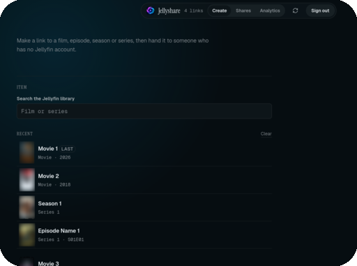
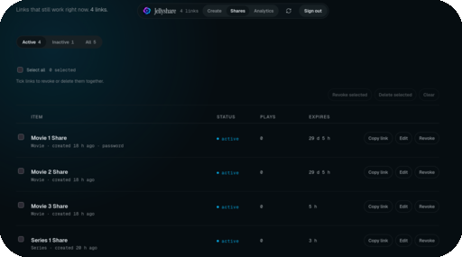
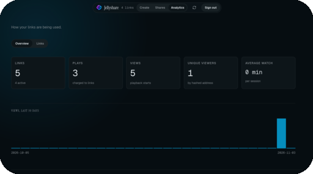
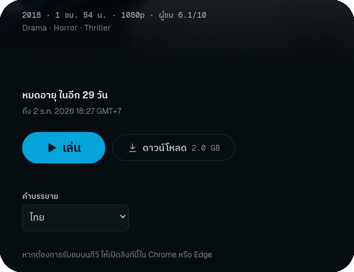

<h1 align="center">Jellyshare</h1>

<p align="center">
  
</p>

<p align="center">
  Temporary, limited links to a film, an episode, a season or a whole series on
  your Jellyfin server; <strong>created and managed from one central admin
  dashboard, with no plugin</strong>, and <strong>shared in Thai or English</strong>.
</p>

> **A note on AI:** Jellyshare is developed by a human with AI assistance
> (mostly DeepSeek Flash) helping write, refactor and review code. I'm all in on
> AI as a development tool. It massively speeds up the work and lets a solo
> developer ship features and fixes at a pace that wouldn't be possible
> otherwise. I'm sharing this openly so you know what's behind the project.

A secure, self-hosted way to hand someone a link to your media without handing
them your Jellyfin server. The link carries its own terms: how long it lasts,
how often it can be played, how many people may watch at once, and an optional
password.

**Everything is created and managed from one central admin dashboard** — search
the library, build a link, set its terms, then edit, revoke, restore, duplicate
or analyse it later. **There is no Jellyfin plugin, no companion app, and no
Jellyfin UI integration to install.**

**The shared link itself is bilingual.** The public page, player, error page,
dates and track names are available in **Thai and English, with Thai as the
default** and an EN/TH pill.

## What does it look like

<table width="100%">
  <tr>
    <td width="50%" align="center">
      
      <br />
      <sub><strong>Create</strong> — Search the Jellyfin library, expand a series to its seasons and episodes, and set expiry, play limits, viewers, quality, password and downloads.</sub>
    </td>
    <td width="50%" align="center">
      
      <br />
      <sub><strong>Shares</strong> — Filter by Active, Inactive or All; edit, copy, revoke, restore, duplicate or delete links one at a time or in bulk.</sub>
    </td>
  </tr>
  <tr>
    <td width="50%" align="center">
      
      <br />
      <sub><strong>Analytics</strong> — Totals, a 30-day views chart, and per-link views, unique viewers, watch time and plays.</sub>
    </td>
    <td width="50%" align="center">
      
      <br />
      <sub><strong>The share page</strong> — Thai by default, with an EN/TH pill, the link's terms, track selectors, downloads and casting.</sub>
    </td>
  </tr>
</table>

## Features

**What sets Jellyshare apart from its forks:**

- **One central admin dashboard, no plugin.** **Create, edit, revoke, restore,
  duplicate and analyse every link in one place.** There is **no Jellyfin
  plugin, no companion app, and no Jellyfin UI integration** to install.
- **Thai share links, not just a Thai admin.** **The public link, player, error
  page, dates and track names are fully Thai**, with Thai as the default and an
  EN/TH pill.

The rest of the feature set:

- **Temporary Share Links** - Create time-limited links that automatically expire
- **Readable Links** - New links use a readable slug plus a random suffix, e.g.
  `/s/mr-mrs-smith-s01-ep-01-2bf3cd802f25`; older random-token links keep working
- **Password Protection** - Optionally protect shares with a password
- **Play Limits** - Set maximum total plays and concurrent viewer limits
- **No Account Required** - Recipients don't need a Jellyfin account
- **Terms Stated Up Front** - "Last of 5 plays · expires in 2 days" sits above
  Play, with the exact end beneath it and a meter of the plays left. The last
  play says what it costs before it is spent, and a link with nothing left says
  so instead of offering controls that could only fail
- **Plain-Language Refusals** - Every error says what happened, whether a play
  was used and what to do next, without codes. A dead link says whether it was
  revoked or expired, and since when
- **Secure Streaming** - Media is proxied through the backend; Jellyfin is never exposed
- **Rich Metadata** - Displays poster, backdrop, ratings, cast, and more
- **Admin Dashboard** - **The only place links are created and managed.** Create
  links, browse the Jellyfin library as a series → season → episode tree, filter
  shares, edit terms, and revoke, restore, duplicate or delete links one at a
  time or in bulk. The picker remembers the last chosen item and the last eight
  shared items. **No plugin is involved**
- **Analytics** - An Analytics tab with Overview and Links sub-tabs: totals, a
  30-day views chart, and per-link views, unique viewers, average watch time and
  plays
- **Full Edit Coverage** - Change expiry, play and viewer limits, quality caps,
  download permission and the password after creation
- **QR and Copy Details** - Copy the link with its password and expiry in one
  block, or show a QR code for phone hand-off
- **Session Tracking** - Monitor active viewers and playback sessions
- **HLS Streaming** - Segments are served through the backend, never from Jellyfin
- **Browser-Compatible Playback** - The codec is negotiated with the viewer's browser,
  so an AV1 or HEVC library plays without being needlessly re-encoded for everyone
- **Audio and Subtitle Tracks** - Selectable below Play, always visible; text
  subtitles are delivered as a WebVTT sidecar, so the video needs no transcode
  and the viewer can switch them off. The first Thai track is selected by
  default when one exists
- **Downloads** - The original file of a film or episode, or a whole season or
  series as one ZIP filed by season. Each download counts as one play and, on a
  link with a play limit, asks first with the file's size and what it costs;
  whoever shares a link can switch downloads off for it
- **Resume and Next Episode** - The server remembers, per link, where it was left
  (on any device, also when watched on a TV), offers to resume, says whose place
  that is, and ticks what was watched; near the end of an episode a card offers
  the next one, which starts on its own unless the viewer cancels
- **Episode List** - Each episode with its overview and a bar for how much of
  it has been seen on this link, and Jellyfin's still on a wider screen
- **Casting** - Google Cast in Chromium browsers and AirPlay in Safari; while
  something plays on a TV the page says so and keeps track of where it is
- **Per-Share Quality** - Cap a single link at 1080p, 720p or 480p without touching
  the library or the server settings
- **Thai and English** - **The shared link, not just the admin UI.** The public
  page, player and error page are available in Thai and English, with Thai as
  the default and an EN/TH pill. Dates use Thai month names with the Gregorian
  calendar, and track language names follow the page language
- **Designed Interface** - The share page leads with the artwork Jellyfin already
  holds and states the link's terms in plain language; the admin surface is a
  single scannable index. Both follow one locked design system
  ([`design.md`](design.md)) anchored on Jellyfin's own accent colour
- **Phone and Keyboard** - Every page fits a phone without sideways scrolling
  and works by keyboard and screen reader: focus returns to where it was after
  the player closes, and each control says what it does

## Recent releases

- **0.5.3** - Strip Jellyfin credentials from HLS manifests and drop the unused
  trickplay image stream.
- **0.5.2** - Serve the web app manifest as `application/manifest+json`, so PWA
  installs and the new maskable icons are picked up reliably.
- **0.5.1** - New vortex brand mark and app icons, a refreshed README with a
  screenshot tour, and upstream credits.
- **0.5.0** - Thai localization for the public page, player and error page, with
  the EN/TH pill, Thai dates and Thai track names.
- **0.4.0** - Renamed the project to Jellyshare: repo, module, image, containers,
  database, env prefix, systemd units and browser keys.
- **0.3.0** - Readable share URLs, Thai subtitle default, picker recents, and the
  deferred-items review.
- **0.2.0** - Analytics tab, QR and copy-details, visible track selectors, full
  edit coverage, restore and duplicate.

See the [releases](https://github.com/melth-cmd/jellyshare/releases) for the
full notes.

## Architecture

```
┌─────────────┐     ┌─────────────────┐     ┌─────────────┐
│   Viewer    │────▶│ Jellyshare API  │────▶│  Jellyfin   │
│  (Browser)  │◀────│   (Go + Svelte) │◀────│   Server    │
└─────────────┘     └─────────────────┘     └─────────────┘
                            │
                            ▼
                    ┌─────────────┐
                    │  PostgreSQL │
                    └─────────────┘
```

**The admin dashboard is the control plane: links are created and managed there,
not in Jellyfin. The viewer only ever sees the public share page.**

## Quick Start

### Prerequisites

- Docker and Docker Compose
- Jellyfin server with API key (10.11 or 12.x — both are supported)
- PostgreSQL (included in docker-compose)

### 1. Clone and Configure

```bash
git clone https://github.com/melth-cmd/jellyshare.git
cd jellyshare

# Copy example environment file
cp .env.example .env
```

### 2. Edit `.env`

```env
# Your Jellyfin server URL
JELLYFIN_URL=http://your-jellyfin-server:8096

# Jellyfin API key (Dashboard → API Keys → Create)
JELLYFIN_API_KEY=your-jellyfin-api-key

# Backend API key for admin access (generate with: openssl rand -hex 32)
BACKEND_API_KEY=your-secure-backend-key

# Public URL where share links will be accessible
PUBLIC_BASE_URL=https://share.yourdomain.com

# Database password
POSTGRES_PASSWORD=your-secure-db-password
```

### 3. Start the Server

The compose file pins the release image tag. Pull it and start:

```bash
docker compose pull jellyshare
docker compose up -d
```

If you prefer to build from the checkout instead:

```bash
docker build -t ghcr.io/melth-cmd/jellyshare:0.5.3 .
docker compose up -d
```

The server will be available at `http://localhost:8097`

### 4. Access Admin Dashboard

Navigate to `http://localhost:8097/admin` and enter your `BACKEND_API_KEY`.

**All link creation and management happens here. There is no Jellyfin plugin to
install.**

The dashboard has three tabs:

- **Create** — search for a film or series, expand a series to its seasons and
  episodes, choose what to share, then set expiry, play and viewer limits,
  quality caps, a password, and whether downloads are allowed. Recently shared
  items and the last chosen item are kept in this browser for a quick return.
- **Shares** — filter by Active, Inactive, or All; select rows with checkboxes
  (shift-click for a range) to revoke or delete in bulk; edit, revoke, restore
  or duplicate any individual link from its row or detail sheet.
- **Analytics** — totals, a 30-day views chart, and per-link views, unique
  viewers, average watch time and plays.

New links use a readable slug plus a random suffix, for example
`/s/mr-mrs-smith-s01-ep-01-2bf3cd802f25`. Older random-token links keep working.

Links are owned by the first Jellyfin user the backend finds at startup. The
create API accepts an explicit `jellyfinUserId` when another owner is needed.

Before exposing the service to the internet, follow
[`docs/DEPLOYMENT.md`](docs/DEPLOYMENT.md).

## Configuration

| Environment Variable | Description | Default |
|---------------------|-------------|---------|
| `JELLYSHARE_PORT` | Server port | `8097` |
| `JELLYSHARE_ENV` | `production` (default) or `development`. Development suppresses the non-fatal production warnings | `production` |
| `JELLYSHARE_JELLYFIN_BASE_URL` | Jellyfin server URL | Required |
| `JELLYSHARE_JELLYFIN_API_KEY` | Jellyfin API key | Required |
| `JELLYSHARE_BACKEND_API_KEY` | Admin API key | Required |
| `JELLYSHARE_PUBLIC_BASE_URL` | Public URL for share links | Required |
| `JELLYSHARE_DB_DSN` | PostgreSQL connection string | Required |
| `JELLYSHARE_SESSION_HEARTBEAT_TIMEOUT_SECONDS` | Session timeout | `120` |
| `JELLYSHARE_RATE_LIMIT_REQUESTS` | Public API calls allowed per IP per window; images and stream segments have their own limit, ten times this | `100` |
| `JELLYSHARE_RATE_LIMIT_WINDOW_SECONDS` | Rate limit window | `60` |
| `JELLYSHARE_MAX_TRANSCODE_BITRATE` | Upper bound for a transcode target, in bits per second. Only applies when Jellyfin transcodes; direct stream is unaffected | `20000000` |
| `JELLYSHARE_STREAM_VIDEO_CODEC` | Fallback video codec, used when the viewer's browser cannot decode the source. A source that already matches is stream-copied, not re-encoded. Empty sends no preference, which lets AV1/HEVC reach the browser untouched | `h264` |
| `JELLYSHARE_STREAM_AUDIO_CODEC` | Audio codec the share page can play, same rule | `aac` |
| `JELLYSHARE_ALLOW_DOWNLOADS` | Offer downloads of the original file, and of a season or series as one ZIP. Each download counts as one play | `true` |
| `JELLYSHARE_SHARE_RETENTION_DAYS` | Days after a link expired or was revoked before its row is deleted. Live and never-expiring links are never deleted. `0` keeps stale rows forever | `365` |

## Security Considerations

- **Jellyfin is never exposed** - All media requests are proxied through the backend
- **HMAC-signed session cookies** - Password sessions use cryptographically signed tokens
- **Bcrypt password hashing** - Share passwords are securely hashed
- **Rate limiting** - Public endpoints are rate-limited to prevent abuse
- **IP hashing** - Client IPs are hashed for privacy in audit logs
- **Automatic session cleanup** - Stale sessions are automatically terminated; links
  are deleted after `JELLYSHARE_SHARE_RETENTION_DAYS` days once expired or revoked
- **Password changes invalidate unlocks** - An unlock cookie is bound to the
  password hash it was issued for, so changing the password asks every viewer
  again instead of leaving old cookies valid
- **Proxy-aware rate limiting** - Forwarded client addresses are trusted only
  from a loopback or private reverse proxy, and only the rightmost
  `X-Forwarded-For` value; a direct client cannot pick its own rate-limit bucket
- **HTTPS-ready cookies and HSTS** - Session cookies are `Secure` on HTTPS (and
  still work on a plain-HTTP LAN), and HSTS is sent only when the request
  arrived over HTTPS. Put the public deployment behind HTTPS
- **No-store admin and private logs** - Admin responses are not cached, share
  tokens, session ids and download tickets are masked in request logs, and all
  responses carry `nosniff`, `SAMEORIGIN`, `no-referrer`, and `noindex` headers
- **Credentials stay server-side** - The Jellyfin key travels as a request header, never
  in a URL that could be echoed back into a manifest the viewer receives. HLS
  manifests are rewritten before they leave the backend, and the unused trickplay
  image stream is dropped
- **Downloads are ticketed** - The item a download serves is checked against the share
  when it is requested and carried in an HMAC-signed ticket that expires after two
  hours; the file request cannot be pointed anywhere else, and the ticket is masked
  in the request log
- **Playback is pinned to the session** - The item, media source, codec, bitrate and
  track selection are resolved once when playback starts. The proxy never takes them
  from a request, so a share link cannot be pointed at another item

## Notable changes

**What sets it apart**

- **One central admin dashboard, no plugin.** Every link is created, edited,
  revoked, restored, duplicated and analysed in the admin page. There is no
  Jellyfin plugin, no companion app, and no Jellyfin UI integration to install.
- **Thai share links, not just a Thai admin.** The public page, player, error
  page, dates and track names are Thai, with Thai as the default and an EN/TH
  pill.

**Security**

- The Jellyfin API key never reaches the viewer. Jellyfin echoes request query
  parameters into the HLS manifests it generates, so the proxy sends the key as a
  header only and strips it from anything the browser receives.
- Playback is pinned to the session. The item, media source, codec, bitrate and
  track selection are resolved once when playback starts; the stream proxy never
  takes them from a later request, so a share link cannot be pointed at another
  item.
- Forwarded client addresses are trusted only from a loopback or private reverse
  proxy, and only the rightmost `X-Forwarded-For` value, so a direct client
  cannot choose its own rate-limit bucket.
- Admin key comparison is constant-time; request bodies are capped; password
  guesses are limited to 10 per minute.
- Unlock cookies are bound to the password hash they were issued for, so changing
  a share password asks every viewer again.
- Share tokens, session ids and download tickets are masked in request logs.
- Admin responses are `no-store`; every response carries `nosniff`,
  `SAMEORIGIN`, `no-referrer` and `noindex`, and HSTS is sent only over HTTPS.
- Download tickets are HMAC-signed, expire after two hours, and carry the item
  they were issued for, so a ticket cannot be pointed anywhere else.
- Client IPs are hashed in audit logs; stale sessions are reaped; expired and
  revoked links are deleted after the retention window.
- `.env` is gitignored and `.dockerignore` keeps it out of the build context.

**Playback**

- The codec is negotiated with the viewer's browser. A source the browser can
  decode is stream-copied; only what it cannot decode is transcoded.
- The transcode target bitrate is derived from the source instead of falling back
  to Jellyfin's 128 kbit/s default.
- Text subtitles are delivered as a WebVTT sidecar, so the video needs no
  re-encode and the viewer can switch them off.
- Audio and subtitle tracks are selectable below Play, always visible. The first
  Thai track is selected by default when one exists.
- Resume is kept per link, not per browser, so a film started on a phone resumes
  on the laptop. The page says whose place it is and offers a restart.
- Near the end of an episode a card offers the next one; it starts on its own
  unless the viewer cancels. Autoplay works in the browser, on Google Cast and
  over AirPlay.
- Google Cast works in Chromium browsers; AirPlay works in Safari; Firefox has no
  casting route. Both need HTTPS and a `JELLYSHARE_PUBLIC_BASE_URL` the TV can
  reach.
- Fullscreen goes to the page, not the video, so the next-episode card survives
  and autoplay keeps working.
- HLS segments are served through the backend, never directly from Jellyfin.

**Downloads**

- A film or episode downloads as the original file; a season or series downloads
  as one ZIP filed by season.
- Each download counts as one play. On a link with a play limit, the page asks
  first with the file's size and what it costs.
- Downloads can be switched off per link, and the server can switch them off for
  every link.
- A download ticket is valid for two hours and supports Range requests, so an
  interrupted download resumes without being charged again.
- The ZIP is stored uncompressed, files episodes by season, and leaves out
  episodes the library lists without a file.
- A download takes no concurrent-viewer slot. A share's quality cap applies to
  streaming only; the download is always the original file.

**Compatibility**

- Jellyfin 10.11 and 12.x with the same build.
- Go 1.27, Node 20, PostgreSQL 16, Svelte 5, Vite 7 and hls.js 1.7.
- Chrome, Edge, Brave and Opera for Google Cast; Safari for AirPlay; Firefox for
  playback without casting.
- Phones and tablets keep their native fullscreen control, which also turns the
  picture to landscape.
- **The public page is available in English and Thai, with Thai as the default.**
- No database schema changes in 0.2.0–0.5.3; upgrades are image-tag changes.

**Interface**

- The viewer page and the admin surface follow one locked design system
  ([`design.md`](design.md)), anchored on Jellyfin's own accent colour.
- The share page leads with the artwork and states the link's terms in words:
  what is left, until when, and what the next tap costs.
- Refusals are sentences: what happened, whether a play was used, and what to do
  next. A dead link says whether it was revoked or expired, and when.
- A spent link says so first and keeps its episodes as a record instead of
  offering controls that could only fail.
- Resume says whose place it goes back to; a season share is titled by its show.
- On a phone every action takes a full line, and a password link keeps its field
  above the keyboard.
- Keyboard and screen reader: focus returns to what was playing when the player
  closes, every view has its landmarks, and an episode's overview is read as its
  row's description.
- The admin dashboard is an index rather than a table: it restacks on a phone,
  revoking asks in the row it affects, and the picker remembers recent items.
- **The admin has Create, Shares and Analytics tabs**; Analytics has Overview
  and Links sub-tabs with totals, a 30-day chart and per-link usage.
- New links use a readable slug plus a random suffix; older random-token links
  keep working.
- **The public page has an EN/TH pill**, Thai dates with the Gregorian calendar,
  and Thai track language names.

## Operations

Backups, the nightly timer, restore, upgrades and rollback are in
[`docs/OPERATIONS.md`](docs/OPERATIONS.md).

## API Reference

The admin and public endpoints, request shapes and response fields are in
[`docs/API.md`](docs/API.md).

## Development

The dev stack, checks, local demo, project structure and build commands are in
[`docs/DEVELOPMENT.md`](docs/DEVELOPMENT.md). Brand assets and how to replace
them are in [`docs/BRANDING.md`](docs/BRANDING.md).

## Credits

Jellyshare is a fork of
[stanislavhannes/jellyfin-share-backend](https://github.com/stanislavhannes/jellyfin-share-backend),
which is a fork of
[monxas/jellyfin-share-backend](https://github.com/monxas/jellyfin-share-backend).
Both are MIT-licensed. See [`CREDITS.md`](CREDITS.md) for details.

## License

MIT License - see [LICENSE](LICENSE) for details.
